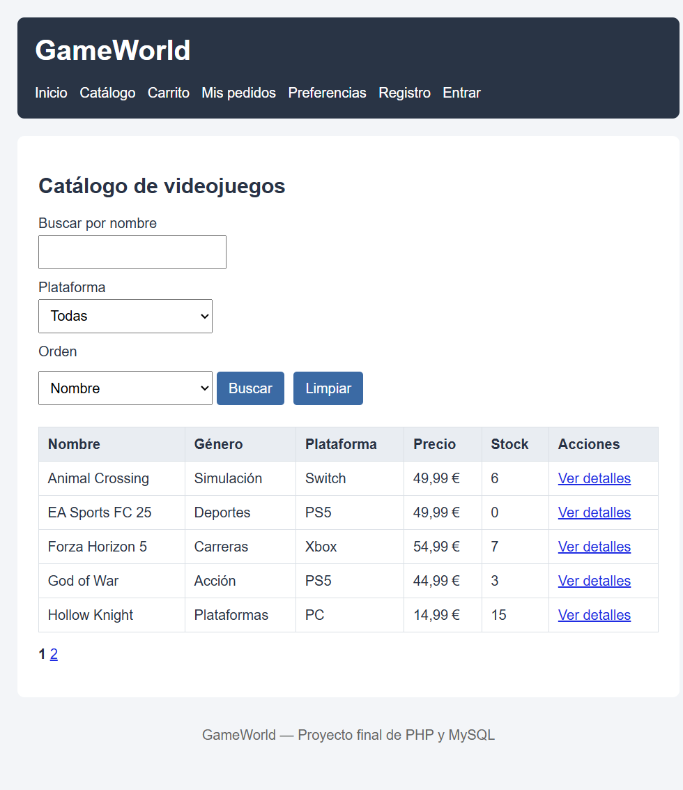
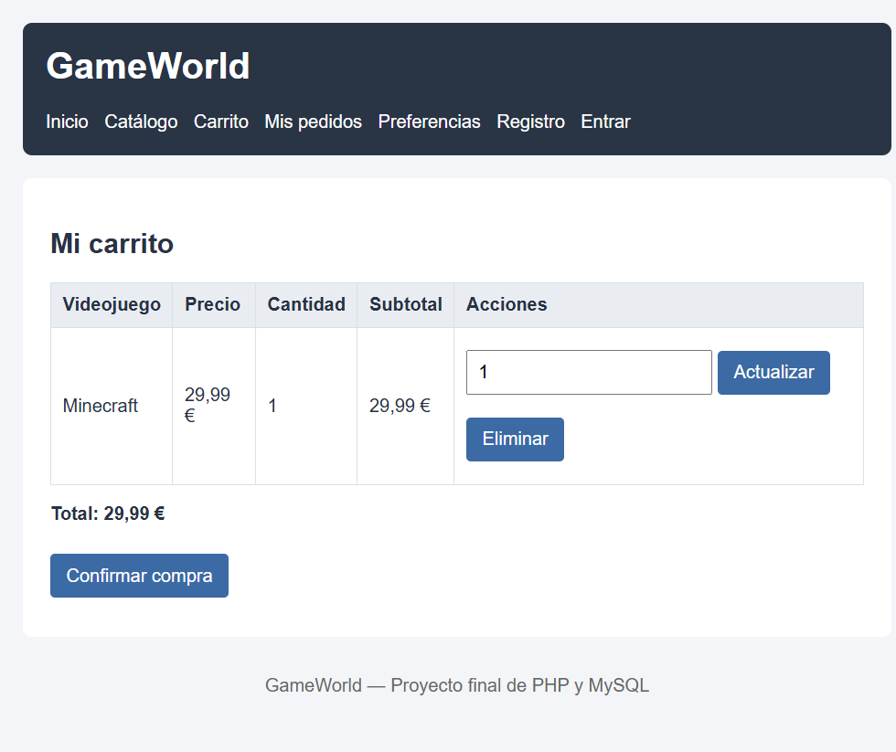
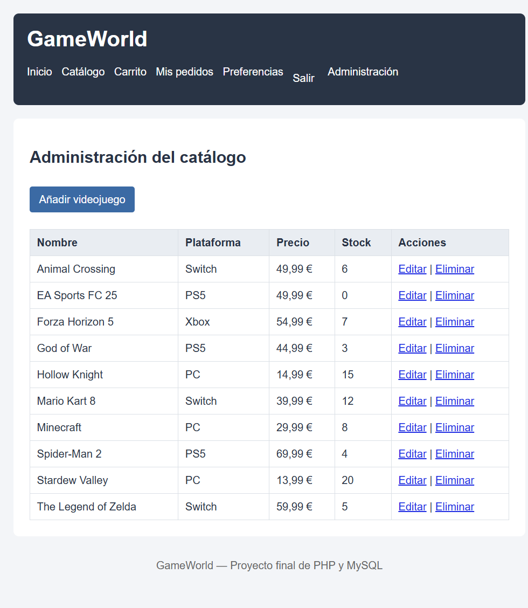

# Pruebas realizadas — GameWorld

## Entorno

- PHP 8.3.33
- MySQL 8.4
- Base de datos `gameworld` importada desde `gameworld.sql`
- Servidor local de pruebas: `http://127.0.0.1:8099`

## Resultados

| Prueba | Resultado esperado | Resultado obtenido |
|---|---|---|
| Registrar un cliente válido | El usuario se guarda en MySQL | Correcto: el usuario se inserta y redirige a `login.php`. |
| Registrar un correo repetido | Se rechaza el registro | Correcto: se muestra «Ese correo electrónico ya está registrado». |
| Introducir una contraseña incorrecta | No se inicia sesión | Correcto: se muestra «Correo electrónico o contraseña incorrectos». |
| Iniciar sesión como administrador | Se permite acceder a administración | Correcto: se muestra el enlace Administración y se accede al listado. |
| Acceder a administración como cliente | Acceso denegado | Correcto: `requiereAdmin()` redirige fuera de administración. |
| Buscar por nombre y plataforma | Solo aparecen los resultados correspondientes | Correcto: por ejemplo, «Mario» + Switch devuelve Mario Kart 8. |
| Cambiar de página en el catálogo | Se mantienen los filtros | Correcto: los enlaces de paginación incluyen búsqueda, plataforma y orden. |
| Añadir dos veces el mismo videojuego | Se acumulan las cantidades | Correcto: se pasa de 2 a 4 unidades. |
| Solicitar más unidades que el stock | Se rechaza la operación | Correcto: se muestra el stock disponible y no se modifica el carrito. |
| Comprar con el carrito vacío | No se registra ningún pedido | Correcto: se muestra «El carrito está vacío» y no se crea ningún pedido. |
| Completar una compra válida | Se guarda el pedido y se descuenta el stock | Correcto: se crea el pedido y sus líneas, y el stock baja de 8 a 4. |
| Consultar pedidos de otro usuario | No se permite el acceso | Correcto: el historial usa siempre el identificador del usuario de la sesión. |
| Añadir un videojuego duplicado | Se rechaza la inserción | Correcto: se muestra «Ya existe un videojuego con ese nombre y plataforma». |
| Eliminar un videojuego incluido en pedidos | Se conserva el videojuego y su historial | Correcto: se muestra un error explicativo y no se borra. |
| Seleccionar el tema oscuro | Se aplica en toda la aplicación | Correcto: la cookie dura 7 días y el tema se mantiene después de cerrar sesión. |
| Cerrar sesión | Se eliminan los datos de autenticación y el carrito | Correcto: se destruye la sesión y se conserva la cookie del tema. |

## Capturas

### Catálogo

### Carrito

### Administración

